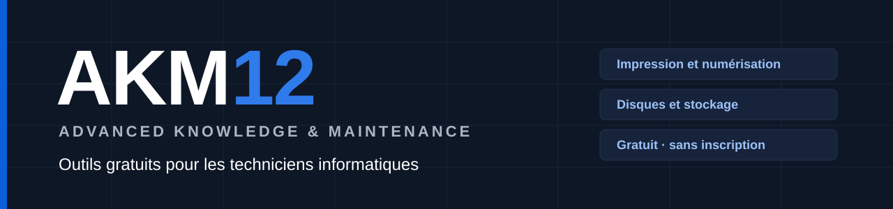
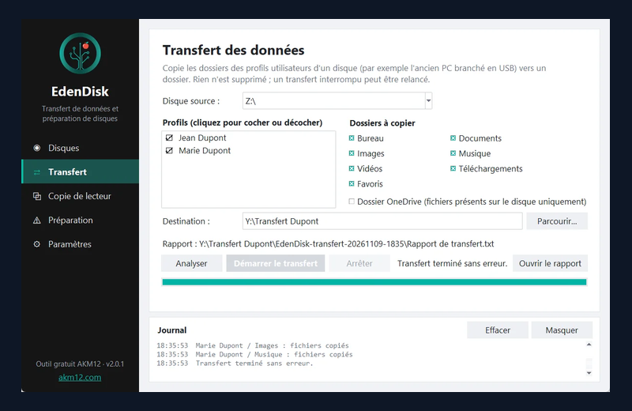
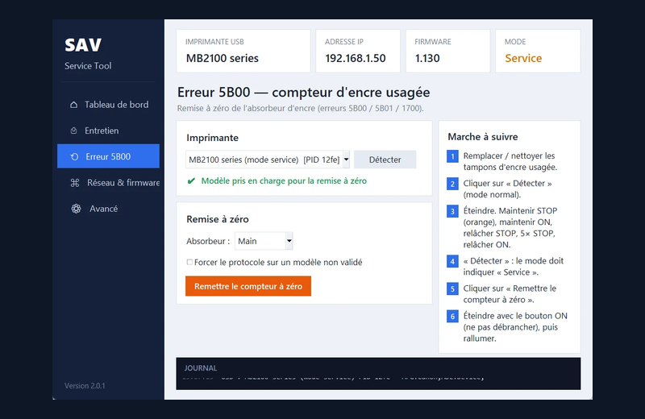
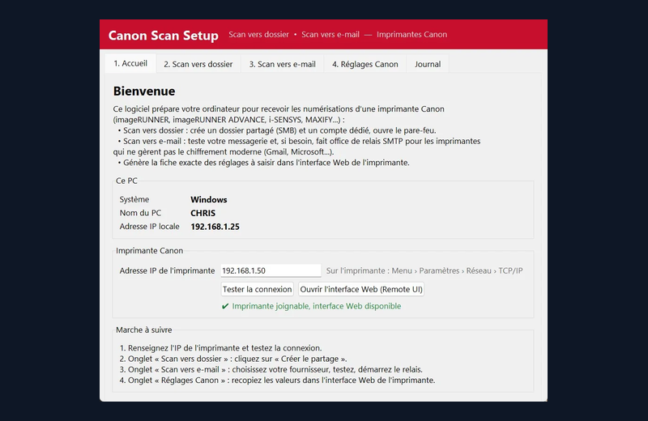
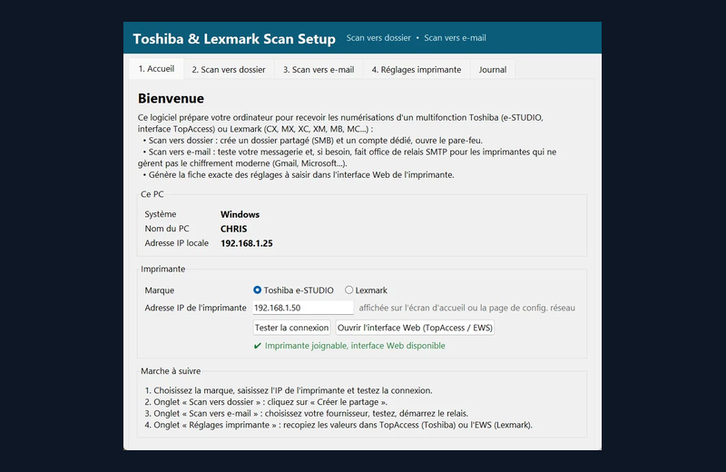
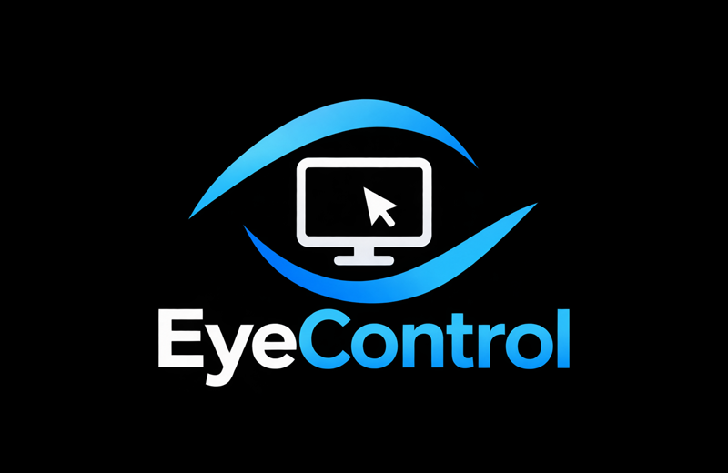
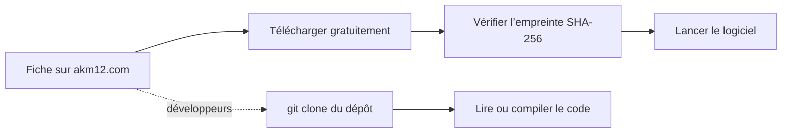

<p align="center">
  <a href="https://akm12.com"></a>
</p>

<p align="center">
  <a href="https://akm12.com"></a>
  <a href="https://github.com/akm12-dev/releases/releases"></a>
  
</p>

<p align="center">
  <b>Des outils simples pour les interventions de tous les jours</b> : imprimantes, numérisation, disques, télémaintenance.<br>
  Chaque logiciel est gratuit, vérifiable (empreinte SHA-256) et accompagné d’un guide PDF.
</p>

## Logiciels

<table>
<tr>
<td width="50%" valign="top">
<a href="https://akm12.com/logiciels/edendisk"></a>

### [EdenDisk](https://akm12.com/logiciels/edendisk)

Transfère les données d’un ancien poste et prépare les disques en toute sécurité.

  

**Windows 10 / 11** · Disques et stockage · Gratuit

[**Télécharger**](https://akm12.com/logiciels/edendisk#recuperer) &nbsp;·&nbsp; [Code source](https://github.com/akm12-dev/edendisk) &nbsp;·&nbsp; [Guide PDF](https://akm12.com/logiciels/edendisk#documentation)
</td>
<td width="50%" valign="top">
<a href="https://akm12.com/logiciels/sav-service-tool"></a>

### [SAV Service Tool](https://akm12.com/logiciels/sav-service-tool)

Remet à zéro le compteur d’encre usagée (erreur 5B00) et entretient les jet d’encre Canon.

  

**Windows 10 / 11** · Impression · Gratuit

[**Télécharger**](https://akm12.com/logiciels/sav-service-tool#recuperer) &nbsp;·&nbsp; [Code source](https://github.com/akm12-dev/sav-service-tool) &nbsp;·&nbsp; [Guide PDF](https://akm12.com/logiciels/sav-service-tool#documentation)
</td>
</tr>
<tr>
<td width="50%" valign="top">
<a href="https://akm12.com/logiciels/canon-scan-setup"></a>

### [Canon Scan Setup](https://akm12.com/logiciels/canon-scan-setup)

Configure le scan vers dossier et le scan vers e-mail des multifonctions Canon.

  

**Windows** · Numérisation · Gratuit

[**Télécharger**](https://akm12.com/logiciels/canon-scan-setup#recuperer) &nbsp;·&nbsp; [Code source](https://github.com/akm12-dev/canon-scan-setup) &nbsp;·&nbsp; [Guide PDF](https://akm12.com/logiciels/canon-scan-setup#documentation)
</td>
<td width="50%" valign="top">
<a href="https://akm12.com/logiciels/toshiba-lexmark-scan-setup"></a>

### [Toshiba &amp; Lexmark Scan Setup](https://akm12.com/logiciels/toshiba-lexmark-scan-setup)

Configure le scan vers dossier et le scan vers e-mail des multifonctions Toshiba et Lexmark.

  

**Windows** · Numérisation · Gratuit

[**Télécharger**](https://akm12.com/logiciels/toshiba-lexmark-scan-setup#recuperer) &nbsp;·&nbsp; [Code source](https://github.com/akm12-dev/toshiba-lexmark-scan-setup) &nbsp;·&nbsp; [Guide PDF](https://akm12.com/logiciels/toshiba-lexmark-scan-setup#documentation)
</td>
</tr>
<tr>
<td width="50%" valign="top">
<a href="https://akm12.com/logiciels/eyecontrol"></a>

### [EyeControl](https://akm12.com/logiciels/eyecontrol)

Console de télémaintenance dans le terminal : connect et l’ID, la prise en main s’ouvre via RustDesk et le serveur AKM12.

  

**Windows 10 / 11 · Linux** · Télémaintenance · Gratuit

[**Télécharger**](https://akm12.com/logiciels/eyecontrol#recuperer) &nbsp;·&nbsp; [Code source](https://github.com/akm12-dev/eyecontrol) &nbsp;·&nbsp; [Guide PDF](https://akm12.com/logiciels/eyecontrol#documentation)
</td>
</tr>
</table>

<sub>Compteurs réels relevés chez GitHub toutes les heures. Les guides PDF et les fichiers d’empreintes ne sont pas comptés comme téléchargements.</sub>

## Récupérer un logiciel



<details>
<summary><b>Cloner le code source</b></summary>
<br>

Le dépôt contient le code et sa documentation, pas forcément un logiciel prêt à lancer : pour simplement l’utiliser, prenez le téléchargement direct sur la fiche.

**EdenDisk**

```bash
git clone https://github.com/akm12-dev/edendisk.git
```

**SAV Service Tool**

```bash
git clone https://github.com/akm12-dev/sav-service-tool.git
```

**Canon Scan Setup**

```bash
git clone https://github.com/akm12-dev/canon-scan-setup.git
```

**Toshiba &amp; Lexmark Scan Setup**

```bash
git clone https://github.com/akm12-dev/toshiba-lexmark-scan-setup.git
```

**EyeControl**

```bash
git clone https://github.com/akm12-dev/eyecontrol.git
```

</details>

<details>
<summary><b>Vérifier un téléchargement (SHA-256)</b></summary>
<br>

Dans PowerShell, depuis le dossier du fichier téléchargé :

```powershell
Get-FileHash .\NomDuFichier.exe -Algorithm SHA256
```

Comparez le résultat avec l’empreinte indiquée sur la fiche du logiciel, ou avec le fichier `SHA256SUMS` joint à chaque [version publiée](https://github.com/akm12-dev/releases/releases). Les exécutables ne sont pas encore signés : Windows SmartScreen peut afficher un avertissement au premier lancement.

</details>

<details>
<summary><b>Modèles compatibles</b></summary>
<br>

**EdenDisk**

| | |
|---|---|
| Disques | Disques reconnus par Windows 10 / 11 (64 bits) ; la préparation refuse toujours le disque système |

**SAV Service Tool**

| | |
|---|---|
| Marque | Canon uniquement, imprimantes jet d’encre |
| Remise à zéro 5B00 | MAXIFY MB2100 / MB2150 (firmware 1.130), G6000 / G6020 |
| Page calibrage et nettoyages | MAXIFY MB2100 / MB2150, série G3000 (non testée par AKM12) |
| Recherche réseau | Imprimantes Canon du réseau local |

**Canon Scan Setup**

| | |
|---|---|
| Matériel | Imprimantes multifonctions Canon compatibles (Remote UI) |

**Toshiba &amp; Lexmark Scan Setup**

| | |
|---|---|
| Matériel | Multifonctions Toshiba e-STUDIO (TopAccess) et Lexmark (Embedded Web Server) |

**EyeControl**

| | |
|---|---|
| Technicien | Windows 10 / 11 ou Linux (non encore essayé sur Kali), avec RustDesk installé |
| PC dépanné | Windows, avec le module de akm12.com/assistance (rien à installer) |

</details>

<details>
<summary><b>Licence</b></summary>
<br>

Code consultable, tous droits réservés : vous pouvez lire, cloner et compiler le code pour votre propre usage. La redistribution, la publication d’une version modifiée et la réutilisation demandent l’accord d’AKM12. Les versions officielles gratuites sont publiées sur [akm12.com](https://akm12.com) et dans [akm12-dev/releases](https://github.com/akm12-dev/releases).

</details>

---

<p align="center">
  <a href="https://akm12.com">akm12.com</a> &nbsp;·&nbsp;
  <a href="https://akm12.com/logiciels">Tous les logiciels</a> &nbsp;·&nbsp;
  <a href="https://akm12.com/documentation">Documentation</a> &nbsp;·&nbsp;
  <a href="https://github.com/akm12-dev/releases/releases">Versions publiées</a>
  <br><sub>Chaîne YouTube : <a href="https://www.youtube.com/@AKM12-tech">AKM12 - Par un tech, pour les tech.</a></sub>
</p>
